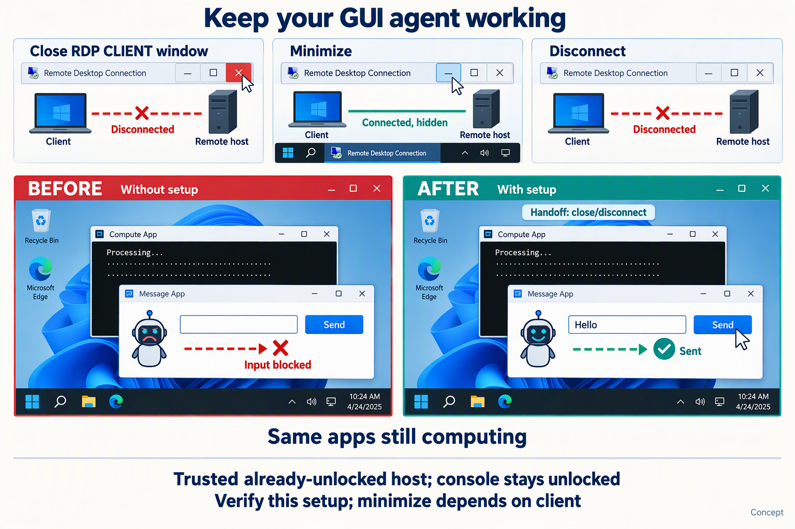

# <bdi dir="ltr">KeepDesktopInteractive</bdi> — <bdi dir="rtl">واصل التفاعل مع واجهة <bdi dir="ltr">GUI</bdi> بعد انقطاع <bdi dir="ltr">RDP</bdi></bdi>

<a id="languages"></a>

<details>
<summary>Languages (16)</summary>

[English](../../README.md) · [简体中文](README.zh-CN.md) · [繁體中文](README.zh-TW.md) · [日本語](README.ja.md) · [한국어](README.ko.md) · [Español](README.es.md) · [Português (Brasil)](README.pt-BR.md) · [Français](README.fr.md) · [Deutsch](README.de.md) · [Italiano](README.it.md) · [Русский](README.ru.md) · [Türkçe](README.tr.md) · [Tiếng Việt](README.vi.md) · [Bahasa Indonesia](README.id.md) · [हिन्दी](README.hi.md) · [العربية](README.ar.md)

</details>

للوكلاء واختبارات الواجهة على سطح مكتب Windows موجود: Windows App هو العميل؛ وقد يكون Microsoft Dev Box أو حاسوب Windows آخر يدعم RDP هو المضيف.



رسم مفاهيمي بعناوين إنجليزية، لا دليل اختبار.

- **واصل النقر والكتابة والتقاط الشاشة.**
- **لا تراقب الاتصال باستمرار.**
- **أعد استخدام سطح المكتب الذي سجّلت الدخول إليه والتطبيقات المفتوحة، دون حفظ كلمات مرور.**

> **يترك نقل الجلسة سطح المكتب البعيد مفتوحًا دون قفل.** من يستطيع تشغيل وحدة التحكم الفعلية أو التفاعلية للجهاز الافتراضي يمكنه استخدام الجلسة دون تسجيل الدخول إلى Windows. لا تستخدم حاسوبًا مشتركًا متاحًا للآخرين أو وحدة تحكم غير موثوقة. لا يدعم التشغيل خلف شاشة مقفلة أو تجاوز السياسات. [الإعداد ومخاطر الوصول](../configuration.md).

يلزم Windows على الحاسوبين. يجب أن يكون المضيف مسجّل الدخول وغير مقفل وخارج وضع السكون، مع سماح السياسات. تلزم موافقة مسؤول المضيف وGit وWindows PowerShell 5.1 وVBScript.

يحاول التشخيص المثبت النقر والكتابة والالتقاط بعد نحو 10 ثوانٍ من كل انقطاع RDP للمستخدم المهيأ، حتى الاستخدام العادي، وقد يتعارض مع الوكيل.

<a id="setup"></a>

## إعداد الحاسوبين

استنسخ نسخة جديدة موثوقة في مجلد المستخدم الحالي الخاص على الحاسوبين، لا في مجلد مشترك قابل للكتابة. افتح <bdi dir="ltr"><code dir="ltr">%LOCALAPPDATA%\KeepDesktopInteractiveSource</code></bdi> في مستكشف الملفات وانقر مرتين على المشغّل المناسب.

<div dir="ltr">

```powershell
git clone https://github.com/yeelam-gordon/KeepDesktopInteractive.git "$env:LOCALAPPDATA\KeepDesktopInteractiveSource"
```

</div>

| المضيف البعيد / العميل المحلي | |
| --- | --- |
| المضيف البعيد | <bdi dir="ltr"><code dir="ltr">start-desktop-session-setup.vbs</code></bdi> — وافق على رفع الصلاحيات |
| العميل المحلي | <bdi dir="ltr"><code dir="ltr">set-local-rdp-minimize-rendering.vbs</code></bdi> — أغلق Windows App/RDP تمامًا ثم افتحه وأعد الاتصال |

[نتائج التثبيت](../configuration.md#quick-setup): المضيف البعيد <bdi dir="ltr"><code dir="ltr">%LOCALAPPDATA%\KeepDesktopInteractive\elevation-result.json</code></bdi> → <bdi dir="ltr"><code dir="ltr">%ProgramData%\KeepDesktopInteractive\setup-result.json</code></bdi>: <bdi dir="ltr"><code dir="ltr">Installed: true</code></bdi>, <bdi dir="ltr"><code dir="ltr">Status: Ready</code></bdi>; العميل المحلي <bdi dir="ltr"><code dir="ltr">%LOCALAPPDATA%\KeepDesktopInteractive\local-rdp-minimize-result.json</code></bdi>: <bdi dir="ltr"><code dir="ltr">Succeeded: true</code></bdi>.

<a id="proof"></a>

## تحقق من الإدخال الحقيقي

قبل الاختبار سجّل وقت البدء، وأوقف أي أتمتة UI أخرى، واحفظ العمل الحساس وأبعد النوافذ السرية؛ الانقطاع يشغّل التشخيص تلقائيًا. تحقق من أن وقت تعديل الملف أحدث من وقت بدء الاختبار المسجّل، وأن <bdi dir="ltr">Passed</bdi> و<bdi dir="ltr">Mode</bdi> يطابقان النتيجة المطلوبة. ثم جرّب نقرًا وكتابة والتقاطًا غير ضار في تطبيق ممثل بدقة وحدة التحكم الناتجة. التشخيص لا يثبت كل التطبيقات.

اقطع الاتصال 30 ثانية ثم أعده. على المضيف افحص <bdi dir="ltr"><code dir="ltr">%LOCALAPPDATA%\KeepDesktopInteractive\desktop-proof.json</code></bdi> المحدّث لهذا الاختبار: <bdi dir="ltr"><code dir="ltr">Passed: true</code></bdi> و<bdi dir="ltr"><code dir="ltr">Mode: AfterDisconnect</code></bdi>.

التصغير مشروط: نفّذ بشكل منفصل [اختبار 90 ثانية / تأخير 60 ثانية](../configuration.md#verify-on-each-new-machine) لوضع <bdi dir="ltr"><code dir="ltr">WhileClientMinimized</code></bdi>. عند الفشل أبقِ النافذة ظاهرة.

<a id="limits"></a>

- بعد إعادة التشغيل سجّل الدخول وافتح القفل وشغّل التطبيقات بنفسك؛ لا دخول تلقائي. القفل البعيد والسكون وتسجيل الخروج قد يوقف العمل.
- التوافق حسب العميل والإصدار، لا اعتماد شامل لـ Dev Box: [الأدلة](../configuration.md#reported-compatibility-evidence).
- Windows Sandbox مصغّر مع استمرار الضيف: **غير متحقق منه**؛ [تجربة](../configuration.md#sandbox-minimized-window-experiment)، لا تعليمات RDP.

## الفشل والتراجع

إذا فشلت النتيجة أو غابت أو كانت قديمة، افحص <bdi dir="ltr"><code dir="ltr">Error</code></bdi> و<bdi dir="ltr"><code dir="ltr">Stage</code></bdi> والتثبيت، ثم أعد الاختبار. [استكشاف الأخطاء](../configuration.md#proof-and-setup-troubleshooting) · [فحوص الإعداد](../configuration.md#configuration-checks)

<a id="undo"></a>

إزالة مهام المضيف واستعادة سجل العميل لا تقفل وحدة التحكم. احفظ وأنهِ الأتمتة؛ اقفل المضيف وتحقق من طلب تسجيل الدخول، أو سجّل الخروج عمدًا لإنهاء التطبيقات.

[التراجع](../configuration.md#undo) · [الدليل المرجعي بالإنجليزية](../configuration.md) · [README بالإنجليزية](../../README.md) · [التحديث](../configuration.md#updating-the-first-prototype)
